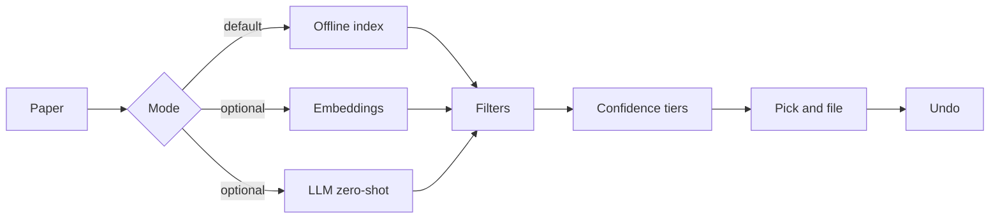

:lucide-folder-down:

# Where does this paper go? One right-click.

PaperRouter ranks the collections in your Zotero library for each paper, with a confidence score, and files a whole batch at once. It works offline with no API key.

[:lucide-download: Download the .xpi](https://github.com/noahweidig/PaperRouter/releases/latest){ .md-button .md-button--primary }
[:lucide-book-open: Install guide](install.md){ .md-button }
[:octicons-mark-github-16: GitHub](https://github.com/noahweidig/PaperRouter){ .md-button }

  
<strong>0</strong><small>API keys needed</small>

  
<strong>3</strong><small>ranking modes</small>

  
<strong>1</strong><small>click to undo</small>

  OfflineOpenAIAnthropicGeminiOpenRouterCohereAny OpenAI-compatible endpoint

- :lucide-list-ordered:{ .lg .middle } **Ranked suggestions**

    ---

    Right-click a paper and get your collections ordered by fit, each with a High, Medium or Low confidence. Hover a row to see why it was suggested.

    [:lucide-arrow-right: Use it](usage.md)

- :lucide-layers:{ .lg .middle } **Batch mode**

    ---

    Select many papers. One window lists each with its top 5 suggestions as toggle chips, best match pre-selected. Filing is one transaction and only adds.

    [:lucide-arrow-right: Batch mode and undo](batch.md)

- :lucide-undo-2:{ .lg .middle } **Undo**

    ---

    Right-click, **Undo last PaperRouter filing**. It reverses additions and removals together and survives a Zotero restart.

    [:lucide-arrow-right: Undo](batch.md#undo)

- :lucide-brain:{ .lg .middle } **Learns from your library**

    ---

    Offline mode profiles each collection from the titles, abstracts, tags and venues of the papers already in it. Collections you reject are down-ranked next time.

    [:lucide-arrow-right: How it works](how-it-works.md)

- :lucide-plug:{ .lg .middle } **Bring your own model**

    ---

    Optional embedding similarity or LLM zero-shot ranking through OpenAI, Anthropic, Gemini, OpenRouter, Cohere or any OpenAI-compatible endpoint.

    [:lucide-arrow-right: Providers](providers.md)

- :lucide-lock:{ .lg .middle } **Private by default**

    ---

    Offline mode sends nothing anywhere. Embedding and LLM modes send only what you enable, to the provider you choose.

    [:lucide-arrow-right: Privacy](privacy.md)

## The ranking pipeline

Requires Zotero 7 to 10.0.x on macOS, Windows or Linux. Free and open source.
